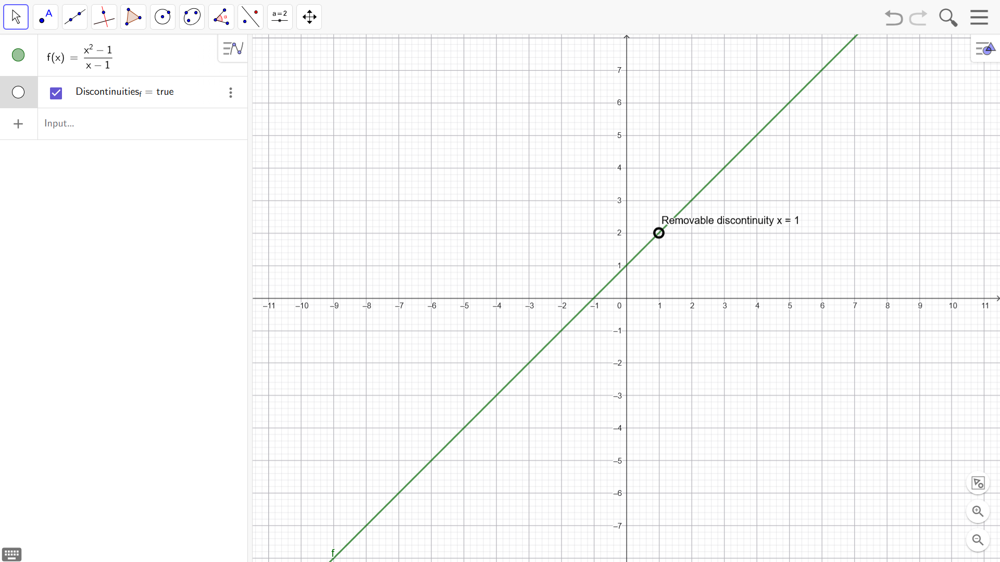

# GeoGebra: Hebbare Definitionslücken anzeigen / Removable Discontinuities

**Language / Sprache:** [🇬🇧 English](#english) · [🇩🇪 Deutsch](#deutsch)

*Beispiel / Example: f(x) = (x²−1)/(x−1), Definitionslücke bei x = 1*

[⬇️ 2D-Skript installieren / Install 2D script](https://raw.githubusercontent.com/HansPeterli/gapsInDefinitionGeoGebra/main/defLuecken.user.js) · [⬇️ 3D-Skript installieren / Install 3D script](https://raw.githubusercontent.com/HansPeterli/gapsInDefinitionGeoGebra/main/defLuecken3D.user.js)

*(Voraussetzung / Requires: [Tampermonkey](https://www.tampermonkey.net/) oder [Userscripts](https://github.com/quoid/userscripts) (iOS))*

---

# 🇬🇧 English

Userscripts for **GeoGebra** that automatically find, mark and update **removable discontinuities** (holes / gaps in the domain of a function) of 2D functions `f(x)` and 3D functions `f(x,y)`.

| Script | For | Shows |
|---|---|---|
| `defLuecken.user.js` | 2D functions `f(x)` | open points `(x \| y)` |
| `defLuecken3D.user.js` | 3D functions `f(x,y)` | points `(x \| y \| z)`, curves and line segments |

Each script is **only active when a matching function exists**: the 2D script ignores everything except `f(x)`, the 3D script ignores everything except `f(x,y)`. Without a matching function they do no work. You can install one or both – they do not interfere with each other.

> ⚠️ **Important:** The scripts only run when GeoGebra is opened in a **browser** (Safari, Chrome, Edge, Firefox, …) – **not** in the native GeoGebra app from the App Store / Play Store. Native apps cannot inject userscripts.

## Contents

- [Requirements](#requirements)
- [Installing on Windows (Chrome, Edge, Firefox)](#installing-on-windows-chrome-edge-firefox)
- [Installing on Android](#installing-on-android)
- [Installing on iOS / iPadOS (Safari)](#installing-on-ios--ipados-safari)
- [Troubleshooting](#troubleshooting)
- [How it works](#how-it-works)
- [Languages](#languages)
- [Limitations](#limitations)

## Requirements

You need a **userscript manager** in your browser – a small extension that loads the script automatically on the GeoGebra page. Recommended:

| Manager | Platforms |
|---|---|
| [Tampermonkey](https://www.tampermonkey.net/) | Windows, Android (via Kiwi/Firefox) |
| [Userscripts](https://github.com/quoid/userscripts) | iOS / iPadOS / macOS (Safari) |

## Installing on Windows (Chrome, Edge, Firefox)

1. **Install Tampermonkey**
   - Chrome/Edge → [Chrome Web Store](https://chromewebstore.google.com/) or Edge Add-ons → search `Tampermonkey` → add.
   - Firefox → [addons.mozilla.org](https://addons.mozilla.org/) → search `Tampermonkey` → add.
2. Click the **Tampermonkey icon** (top right) → open the **Dashboard**.
3. Click **"Create a new script"** or the **"+"** icon.
4. Copy the complete content of `defLuecken.user.js` (2D) and/or `defLuecken3D.user.js` (3D) into the editor (delete the sample text first). Use one new script per file.
5. Save with <kbd>Ctrl</kbd> + <kbd>S</kbd>.
6. Open GeoGebra: [geogebra.org/classic](https://www.geogebra.org/classic) (reload the page if it was already open). For the 3D script, [geogebra.org/3d](https://www.geogebra.org/3d) works too.

✅ **Check:** <kbd>F12</kbd> → "Console" tab → you should see messages such as `[Lücken] GeoGebra vollständig bereit` (2D) or `[Lücken3D] Script gestartet` (3D).

## Installing on Android

Standard Chrome on Android does **not** support extensions. Two alternatives:

<b>Option A – Firefox for Android</b>

1. Install [Firefox](https://play.google.com/store/apps/details?id=org.mozilla.firefox) from the Play Store.
2. Menu → **Add-ons** → search `Tampermonkey` → install.
3. Paste the script into the Tampermonkey dashboard as usual and save.
4. Open GeoGebra in Firefox.

<b>Option B – Kiwi Browser</b>

1. Install [Kiwi Browser](https://play.google.com/store/apps/details?id=com.kiwibrowser.browser) from the Play Store.
2. Open Kiwi Browser → menu (⋮) → **Extensions**.
3. **"Load more extensions"** → Chrome Web Store → install `Tampermonkey`.
4. Open the Tampermonkey dashboard → new script → paste the content of `defLuecken.user.js` and/or `defLuecken3D.user.js` → save.
5. Open GeoGebra in Kiwi Browser: [geogebra.org/classic](https://www.geogebra.org/classic).

## Installing on iOS / iPadOS (Safari)

<b>Userscripts (free, open source)</b>

1. Install the free app [`Userscripts`](https://apps.apple.com/app/userscripts/id1463298887) from the App Store.
2. **Settings** → **Safari** → **Extensions** → enable `Userscripts` and allow website access.
3. In the Userscripts app, create/select a folder for scripts and put `defLuecken.user.js` and/or `defLuecken3D.user.js` there (e.g. via the Files app: **Share** → **Save to Files** → chosen folder).
4. Open Safari → load GeoGebra – the script is applied automatically.

> 💡 After iOS updates the extension is sometimes disabled. If the script suddenly stops working, check **Settings → Safari → Extensions**.

## Troubleshooting

| Problem | Solution |
|---|---|
| Script does nothing | Check that the userscript manager is **active** for the current page (the icon in the address bar/toolbar shows the status). Reload the page completely. |
| Script does nothing, although the manager is active | The 2D script only reacts to `f(x)`, the 3D script only to `f(x,y)`. Check that a matching function exists. |
| No console messages | Only checkable on desktop: <kbd>F12</kbd> → **Console**. You should see `[Lücken] …` (2D) or `[Lücken3D] …` (3D) lines. |
| No gaps visible | The gaps are hidden until you tick the checkbox of the function (see below). |
| Opens in the native app instead of the browser | Type `https://www.geogebra.org/classic` directly into the address bar instead of tapping a short link. |
| URL does not match `@match`/`@include` | In the Tampermonkey editor, check whether the opened GeoGebra URL matches the patterns in the script header; add yours if necessary. |
| Wrong label language | See [Languages](#languages). |

## How it works

**Both scripts**

- Detect matching functions automatically and create a control checkbox for each. Both its **name** and its label follow your GeoGebra language, e.g. `Lücken_<name>` / `Lücken3D_<name>` in German or `Discontinuities_<name>` / `Discontinuities3D_<name>` in English (see [Languages](#languages)). The checkbox is **off by default**. If you switch the language, the existing checkbox is renamed at the next re-analysis.
- A gap is **only visible** if the checkbox is **ticked** **and** the function itself is **visible**.
- React **immediately** (event-based via `registerClientListener` / `registerObjectUpdateListener`) to: visibility toggles, clicks on the checkbox, and adding, changing, deleting or renaming functions, as well as changes of slider values.
- A `setInterval` fallback (every 2 seconds) catches edge cases that trigger no events. It only runs while at least one matching function exists.

**2D script (`f(x)`)**

- Looks for zeros of the denominator and marks every removable gap as an open point, labelled with its exact coordinates where possible (e.g. `π/2`, `1/3`).
- Points follow slider parameters live.

**3D script (`f(x,y)`)**

- Searches the denominator for zeros inside the visible area of the 3D view (plus a margin) and checks numerically that the limit exists and is the same from every direction. Poles (like `1/(x²+y²)`) and direction-dependent limits (like `xy/(x²+y²)`) are **not** reported.
- **Isolated gaps** (e.g. `sin(x²+y²)/(x²+y²)` at the origin) are shown as points `(x | y | z)`.
- **Gaps along a curve** (e.g. `(x²−1)/(x−1)`, the whole line `x = 1`) are shown as a curve, in this order of preference:
  1. **Live curve:** GeoGebra's CAS simplifies `f` (`Simplify`) and solves the denominator for `y` (`Solve`). The curve `(u, h(u), f_simplified(u, h(u)))` depends directly on your sliders.
  2. **Limit curve:** the height `z` is computed with a CAS limit, using the current parameter values (recalculated when a parameter changes).
  3. **Line segment** if the points lie on a straight line.
  4. **Row of points** otherwise.
- Every curve is only drawn if at least 3 numerically verified gap points lie on it.

## Languages

Labels follow the language of GeoGebra automatically and use the usual mathematical term:

| Language | Label | Checkbox name |
|---|---|---|
| Deutsch | Definitionslücke | `Lücken_…` |
| English | Removable discontinuity | `Discontinuities_…` |
| Français | Discontinuité éliminable | `Discontinuités_…` |
| Español | Discontinuidad evitable | `Discontinuidades_…` |
| Italiano | Discontinuità eliminabile | `Discontinuità_…` |
| Português | Descontinuidade removível | `Descontinuidades_…` |
| Nederlands | Hefbare discontinuïteit | `Discontinuïteiten_…` |
| Polski | Nieciągłość usuwalna | `Nieciągłości_…` |
| Čeština | Odstranitelná nespojitost | `Nespojitosti_…` |
| Русский | Устранимый разрыв | `Разрывы_…` |
| Türkçe | Kaldırılabilir süreksizlik | `Süreksizlikler_…` |

All other languages fall back to English. The language is read from GeoGebra (`getLanguage`, if available), then from the URL parameter `?lang=…`, then from the page and browser language. Existing labels are updated the next time a function is re-analysed. Console messages stay in German.

## Limitations

- The 3D script is new and has not been tested on all kinds of functions. Please report functions where only points appear instead of a curve, or where gaps are missed.
- 3D: gaps along double zero curves such as `(x−1)²` in the denominator are not detected. Gaps along curved lines that CAS cannot solve are shown as a row of points.
- 3D: the search is limited to roughly 10 seconds per function; with very many denominators, only what was found by then is shown.
- Only functions with a **denominator** are analysed (as in the 2D script).

---

# 🇩🇪 Deutsch

Userscripts für **GeoGebra**, die **hebbare Definitionslücken** (hebbare Unstetigkeiten) von 2D-Funktionen `f(x)` und 3D-Funktionen `f(x,y)` automatisch erkennen, markieren und aktuell halten.

| Skript | Für | Zeigt |
|---|---|---|
| `defLuecken.user.js` | 2D-Funktionen `f(x)` | offene Punkte `(x \| y)` |
| `defLuecken3D.user.js` | 3D-Funktionen `f(x,y)` | Punkte `(x \| y \| z)`, Kurven und Strecken |

Jedes Skript wird **nur aktiv, wenn es eine passende Funktion gibt**: Das 2D-Skript beachtet nur `f(x)`, das 3D-Skript nur `f(x,y)`. Ohne passende Funktion tun sie nichts. Du kannst eines oder beide installieren – sie stören sich nicht.

> ⚠️ **Wichtig:** Die Skripte laufen nur, wenn GeoGebra im **Browser** geöffnet wird (z. B. Safari, Chrome, Edge, Firefox) – **nicht** in der nativen GeoGebra-App aus dem App Store / Play Store. In nativen Apps können keine Userscripts injiziert werden.

## Inhaltsverzeichnis

- [Voraussetzungen](#voraussetzungen)
- [Installation unter Windows (Chrome, Edge, Firefox)](#installation-unter-windows-chrome-edge-firefox)
- [Installation unter Android](#installation-unter-android)
- [Installation unter iOS / iPadOS (Safari)](#installation-unter-ios--ipados-safari)
- [Fehlerbehebung](#fehlerbehebung)
- [Funktionsweise](#funktionsweise)
- [Sprachen](#sprachen)
- [Einschränkungen](#einschränkungen)

## Voraussetzungen

Du brauchst in jedem Browser einen **Userscript-Manager** – eine kleine Erweiterung, die das Skript automatisch auf der GeoGebra-Seite lädt. Empfohlen:

| Manager | Plattformen |
|---|---|
| [Tampermonkey](https://www.tampermonkey.net/) | Windows, Android (via Kiwi/Firefox) |
| [Userscripts](https://github.com/quoid/userscripts) | iOS / iPadOS / macOS (Safari) |

## Installation unter Windows (Chrome, Edge, Firefox)

1. **Tampermonkey installieren**
   - Chrome/Edge → [Chrome Web Store](https://chromewebstore.google.com/) bzw. Edge Add-ons → `Tampermonkey` suchen → hinzufügen.
   - Firefox → [addons.mozilla.org](https://addons.mozilla.org/) → `Tampermonkey` suchen → hinzufügen.
2. Auf das **Tampermonkey-Symbol** oben rechts im Browser klicken → **Dashboard** öffnen.
3. Reiter **„Neues Skript“** bzw. das **„+“**-Symbol anklicken.
4. Den kompletten Inhalt von `defLuecken.user.js` (2D) und/oder `defLuecken3D.user.js` (3D) in den Editor kopieren (Beispieltext vorher löschen). Pro Datei ein neues Skript anlegen.
5. Mit <kbd>Strg</kbd> + <kbd>S</kbd> speichern.
6. GeoGebra öffnen: [geogebra.org/classic](https://www.geogebra.org/classic) (Seite ggf. neu laden, falls schon offen). Für das 3D-Skript geht auch [geogebra.org/3d](https://www.geogebra.org/3d).

✅ **Kontrolle:** <kbd>F12</kbd> → Tab „Konsole“ → es sollten Meldungen wie `[Lücken] GeoGebra vollständig bereit` (2D) bzw. `[Lücken3D] Script gestartet` (3D) erscheinen.

## Installation unter Android

Der Standard-Chrome auf Android unterstützt **keine** Erweiterungen. Zwei Alternativen:

<b>Variante A – Firefox für Android</b>

1. [Firefox](https://play.google.com/store/apps/details?id=org.mozilla.firefox) aus dem Play Store installieren.
2. Menü → **Add-ons** → `Tampermonkey` suchen → installieren.
3. Skript wie gewohnt im Tampermonkey-Dashboard einfügen und speichern.
4. GeoGebra in Firefox öffnen.

<b>Variante B – Kiwi Browser</b>

1. [Kiwi Browser](https://play.google.com/store/apps/details?id=com.kiwibrowser.browser) aus dem Play Store installieren.
2. Kiwi Browser öffnen → Menü (⋮) → **Extensions**.
3. **„Weitere Erweiterungen laden“** → Chrome Web Store → `Tampermonkey` installieren.
4. Tampermonkey-Dashboard öffnen → neues Skript → Inhalt von `defLuecken.user.js` und/oder `defLuecken3D.user.js` einfügen → speichern.
5. GeoGebra in Kiwi Browser öffnen: [geogebra.org/classic](https://www.geogebra.org/classic).

## Installation unter iOS / iPadOS (Safari)

<b>Userscripts (kostenlos, Open Source)</b>

1. Im App Store die kostenlose App [`Userscripts`](https://apps.apple.com/app/userscripts/id1463298887) installieren.
2. **Einstellungen** → **Safari** → **Erweiterungen** → `Userscripts` aktivieren und Website-Zugriff erlauben.
3. In der Userscripts-App einen Ordner für Skripte anlegen/auswählen und `defLuecken.user.js` und/oder `defLuecken3D.user.js` dort ablegen (z. B. über die Dateien-App: **Teilen** → **In Dateien sichern** → gewählter Ordner).
4. Safari öffnen → GeoGebra laden – das Skript greift automatisch.

> 💡 Nach iOS-Updates wird die Erweiterung manchmal deaktiviert. Reagiert das Skript plötzlich nicht mehr: **Einstellungen → Safari → Erweiterungen** prüfen.

## Fehlerbehebung

| Problem | Lösung |
|---|---|
| Skript reagiert gar nicht | Prüfen, ob der Userscript-Manager für die aktuelle Seite **aktiv** ist (Symbol in der Adressleiste/Toolbar zeigt Status). Seite komplett neu laden. |
| Skript reagiert nicht, obwohl der Manager aktiv ist | Das 2D-Skript reagiert nur auf `f(x)`, das 3D-Skript nur auf `f(x,y)`. Prüfen, ob eine passende Funktion existiert. |
| Keine Konsolen-Meldungen | Nur am Desktop sinnvoll prüfbar: <kbd>F12</kbd> → **Konsole**. Dort sollten `[Lücken] …`- (2D) bzw. `[Lücken3D] …`-Zeilen (3D) erscheinen. |
| Keine Lücken sichtbar | Die Lücken sind ausgeblendet, bis du die Checkbox der Funktion aktivierst (siehe unten). |
| Öffnet sich in nativer App statt Browser | Direkt `https://www.geogebra.org/classic` in die Adressleiste eingeben statt einen Kurzlink zu antippen. |
| URL passt nicht zu `@match`/`@include` | Im Tampermonkey-Editor prüfen, ob die geöffnete GeoGebra-URL zu den im Skriptkopf hinterlegten Adressmustern passt; ggf. ergänzen. |
| Falsche Sprache bei der Beschriftung | Siehe [Sprachen](#sprachen). |

## Funktionsweise

**Beide Skripte**

- Erkennen passende Funktionen automatisch und legen für jede eine Steuer-Checkbox an. Sowohl ihr **Name** als auch ihre Beschriftung richten sich nach der Sprache deines GeoGebra, z. B. `Lücken_<Name>` / `Lücken3D_<Name>` auf Deutsch oder `Discontinuities_<Name>` / `Discontinuities3D_<Name>` auf Englisch (siehe [Sprachen](#sprachen)). Die Checkbox ist **standardmäßig aus**. Wechselst du die Sprache, wird die vorhandene Checkbox bei der nächsten Neuanalyse umbenannt.
- Eine Lücke ist **nur sichtbar**, wenn:
  - die zugehörige Checkbox **aktiviert** ist, **und**
  - die Funktion selbst **sichtbar** ist.
- Reagieren **sofort** (event-basiert über `registerClientListener` / `registerObjectUpdateListener`) auf: Sichtbarkeits-Toggle der Funktion, Klick auf die Steuer-Checkbox, Hinzufügen, Ändern, Löschen oder Umbenennen von Funktionen sowie Änderungen von Schiebereglern.
- Ein `setInterval`-Fallback (alle 2 Sekunden) fängt Randfälle ab, die keine Events auslösen. Er läuft nur, solange mindestens eine passende Funktion existiert.

**2D-Skript (`f(x)`)**

- Sucht Nullstellen des Nenners und markiert jede hebbare Lücke als offenen Punkt, wenn möglich mit exakten Koordinaten beschriftet (z. B. `π/2`, `1/3`).
- Die Punkte folgen Schieberegler-Parametern live.

**3D-Skript (`f(x,y)`)**

- Sucht Nullstellen des Nenners im sichtbaren Bereich der 3D-Ansicht (plus Rand) und prüft numerisch, ob der Grenzwert existiert und aus jeder Richtung gleich ist. Polstellen (wie `1/(x²+y²)`) und richtungsabhängige Grenzwerte (wie `xy/(x²+y²)`) werden **nicht** gemeldet.
- **Isolierte Lücken** (z. B. `sin(x²+y²)/(x²+y²)` im Ursprung) erscheinen als Punkte `(x | y | z)`.
- **Lücken entlang einer Kurve** (z. B. `(x²−1)/(x−1)`, die ganze Gerade `x = 1`) erscheinen als Kurve, in dieser Rangfolge:
  1. **Live-Kurve:** Das GeoGebra-CAS kürzt `f` (`Simplify`) und löst den Nenner nach `y` auf (`Solve`). Die Kurve `(u, h(u), f_gekürzt(u, h(u)))` hängt direkt an deinen Schiebereglern.
  2. **Grenzwert-Kurve:** Die Höhe `z` kommt aus einem CAS-Grenzwert mit den aktuellen Parameterwerten (wird bei Parameteränderung neu berechnet).
  3. **Strecke**, wenn die Punkte auf einer Geraden liegen.
  4. **Punktreihe** sonst.
- Jede Kurve wird nur gezeichnet, wenn mindestens 3 numerisch geprüfte Lückenpunkte darauf liegen.

## Sprachen

Die Beschriftungen übernehmen automatisch die Sprache von GeoGebra und verwenden den jeweils üblichen Fachbegriff:

| Sprache | Beschriftung | Name der Checkbox |
|---|---|---|
| Deutsch | Definitionslücke | `Lücken_…` |
| English | Removable discontinuity | `Discontinuities_…` |
| Français | Discontinuité éliminable | `Discontinuités_…` |
| Español | Discontinuidad evitable | `Discontinuidades_…` |
| Italiano | Discontinuità eliminabile | `Discontinuità_…` |
| Português | Descontinuidade removível | `Descontinuidades_…` |
| Nederlands | Hefbare discontinuïteit | `Discontinuïteiten_…` |
| Polski | Nieciągłość usuwalna | `Nieciągłości_…` |
| Čeština | Odstranitelná nespojitost | `Nespojitosti_…` |
| Русский | Устранимый разрыв | `Разрывы_…` |
| Türkçe | Kaldırılabilir süreksizlik | `Süreksizlikler_…` |

Alle anderen Sprachen fallen auf Englisch zurück. Die Sprache wird aus GeoGebra gelesen (`getLanguage`, falls vorhanden), danach aus dem URL-Parameter `?lang=…`, dann aus der Seiten- und Browsersprache. Bereits vorhandene Beschriftungen werden bei der nächsten Neuanalyse der Funktion aktualisiert. Konsolenmeldungen bleiben deutsch.

## Einschränkungen

- Das 3D-Skript ist neu und noch nicht mit allen Funktionstypen getestet. Bitte Funktionen melden, bei denen nur Punkte statt einer Kurve erscheinen oder Lücken fehlen.
- 3D: Lücken entlang doppelter Nullstellenkurven wie `(x−1)²` im Nenner werden nicht erkannt. Lücken entlang gekrümmter Linien, die das CAS nicht auflösen kann, erscheinen als Punktreihe.
- 3D: Die Suche ist pro Funktion auf etwa 10 Sekunden begrenzt; bei sehr vielen Nennern wird nur angezeigt, was bis dahin gefunden wurde.
- Analysiert werden nur Funktionen mit **Nenner** (wie beim 2D-Skript).
